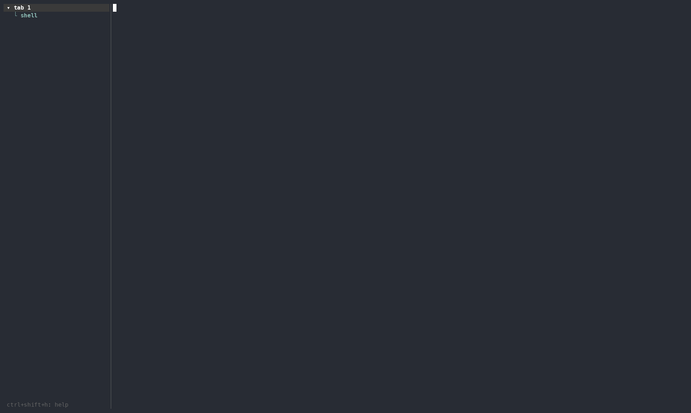

# haunt

A small terminal multiplexer that runs inside your terminal and shows your
tabs as a tree in a sidebar on the left, with each tab's panes listed under it.



haunt is deliberately simple: there's no config file and no themes.
Everything is a constant in the source, so change the code if you want
different behavior. Named sessions keep running in the background like
`screen` or `tmux`, so you can close the terminal and pick up where you left
off, and they're saved to disk so they survive a reboot or a crash too.

## Features

- **Tree-style tab sidebar.** Fold and unfold tabs, click to switch, and long
  names are cut off with "…".
- **Splits.** Put panes side by side or stacked, and move between them.
- **Real terminal emulation** via [alacritty_terminal](https://crates.io/crates/alacritty_terminal):
  vim, htop, less and lazygit work, with truecolor, alternate screen, mouse
  reporting and cursor shapes.
- **Per-pane scrollback** (10,000 lines) with the mouse wheel.
- **Mouse support.** Click tabs and panes in the sidebar, click a pane to
  focus it, and scroll over any pane.
- **Single-chord shortcuts** (Ctrl+Shift+…), with no prefix key to press first.
- **Detachable sessions.** `haunt attach work` keeps your shells running in
  the background; close the terminal and attach again from any other one.
- **Saved sessions.** A session's tabs, splits, folders and text are saved
  as it runs, so they come back after a reboot or a crash.
- **Always restores your terminal** on exit, even if haunt crashes.

## Requirements

- **Rust 1.88 or newer** ([rustup.rs](https://rustup.rs)).
- **macOS or Linux.** It has been tested on macOS. Linux should work, and
  Windows isn't supported.
- **A terminal that supports the
  [kitty keyboard protocol](https://sw.kovidgoyal.net/kitty/keyboard-protocol/)**,
  such as Ghostty, kitty, WezTerm, foot or Alacritty. haunt needs it to tell
  Ctrl+Shift+T apart from Ctrl+T. In terminals without it, such as macOS
  Terminal.app, the shortcuts won't work.

## Install

```sh
git clone https://github.com/alivanz/haunt.git
cd haunt
./install.sh
```

`install.sh` builds haunt and installs the `haunt` binary to `~/.cargo/bin`,
which rustup normally adds to your `PATH`. Then run it from anywhere:

```sh
haunt
```

If you've changed the source, run `./install.sh` again to install the new
build. To try changes without installing, run `cargo run --release` in the
repo instead.

To uninstall, run `cargo uninstall haunt`.

## Usage

haunt starts with one tab running your login shell. Press **Ctrl+Shift+H**
at any time to see all the shortcuts.

| Keys             | Action                                           |
|------------------|--------------------------------------------------|
| `Ctrl+Shift+T`   | new tab                                          |
| `Ctrl+Shift+W`   | close the focused pane (closes the tab if it's the last pane) |
| `Ctrl+Shift+\|`  | split: new pane to the right                     |
| `Ctrl+Shift+_`   | split: new pane below                            |
| `Ctrl+Shift+↑/↓` | previous / next tab                              |
| `Ctrl+Shift+←/→` | previous / next pane in the current tab          |
| `Ctrl+Shift+R`   | rename the current tab (Enter saves, Esc cancels, Ctrl+U clears) |
| `Ctrl+Shift+S`   | focus the sidebar (press again to leave)         |
| `Ctrl+Shift+B`   | hide / show the sidebar                          |
| `Ctrl+Shift+H`   | show the shortcuts popup                         |
| `Ctrl+Shift+D`   | detach from a session, leaving it running        |
| `Ctrl+Shift+Q`   | quit (a session is saved first)                  |

**In the sidebar:** `j`/`k` or the arrow keys move, `Enter` switches to the
selected tab or pane, `Space` folds or unfolds a tab, and `Esc` returns to
the panes.

**Mouse:**
- Click a tab or pane in the sidebar to switch to it, or click the `▸`/`▾`
  arrow to fold the tab.
- Click a pane to focus it.
- Scroll over a pane to move through its history. A yellow `[n/total]` marker
  shows how far back you are, and typing jumps back to the bottom.
- Programs that use the mouse (vim with `mouse=a`, htop, lazygit) receive
  clicks and scrolls directly.
- To select text with your terminal's own selection, hold **Shift** while
  dragging.

When a shell exits, its pane closes. When the last pane closes, haunt exits
(for a session, the session ends).

If a shortcut does nothing, your terminal probably has its own keybinding on
that key. Remove that binding in the terminal's settings, or change the key
in `src/input.rs`.

## Sessions

Plain `haunt` lives and dies with its terminal. For anything you want to
keep, use a named session:

```sh
haunt attach work    # show session "work", starting it if needed (short: haunt a work)
haunt ls             # list running and saved sessions
haunt kill work      # stop "work" and delete its saved copy
```

A session runs in a background server, so your shells and the programs in
them (builds, servers, `claude`) keep running when you:
- press `Ctrl+Shift+D` to detach, or
- close the terminal window.

Run `haunt attach work` from any terminal to get it back, including over
`ssh`. A session shows in one terminal at a time: attaching from a second
one takes it over from the first. The sidebar shows `[work]` at the bottom.

While it runs, a session is also saved to disk every few seconds. If the
server stops (reboot, crash, or `Ctrl+Shift+Q`), the next
`haunt attach work` brings back:
- every tab, with its name, splits and folded state
- each pane's text and scrollback, with colors, followed by a `── restored ──` line
- a fresh shell in each pane, in the folder it was in

Programs that were running aren't restarted after that; only their text is
kept. If vim or another full-screen program was open, you get back the
shell text from before it started.

- `Ctrl+Shift+D` detaches; the session keeps running.
- `Ctrl+Shift+Q` stops the session and keeps the saved copy for next time.
- Exiting every shell (typing `exit` in the last pane) ends the session and
  deletes it.

Saved sessions are in `~/.local/state/haunt/sessions/` (or
`$XDG_STATE_HOME/haunt/sessions/`). If a session fails to start, its error
is printed, and also kept in `NAME.log` there. Running sessions listen on a
socket in `/tmp/haunt-UID/` (or `$XDG_RUNTIME_DIR/haunt/`) that only your
user can use.

## Customizing

There's no config file. Edit the source and run `./install.sh` again.

| What                    | Where                                               |
|-------------------------|-----------------------------------------------------|
| Shortcuts               | `shortcut()` in `src/input.rs`; also update the `HELP` list next to it |
| Sidebar width           | `WIDTH` in `src/ui/sidebar.rs`                      |
| Scrollback length       | `SCROLLBACK` in `src/pane.rs`                       |
| Lines per scroll tick   | `SCROLL_LINES` in `src/app.rs`                      |
| Session save interval   | `SAVE_INTERVAL` in `src/app.rs`                     |
| Sidebar colors          | `render()` in `src/ui/sidebar.rs`                   |

## Code map

- `src/main.rs`: the `haunt` subcommands
- `src/app.rs`: app state (tabs, panes, modes), the event loop, session restore and autosave, and the attached client
- `src/server.rs`: the background server for a session: starting it, the socket, and clients
- `src/client.rs`: `haunt attach` and `haunt kill`
- `src/protocol.rs`: the messages between client and server
- `src/screen.rs`: a ratatui backend that draws into a buffer, so frames can go over the socket
- `src/tty.rs`: sets up the outer terminal and restores it on exit and on panic
- `src/session.rs`: the session file format, saving, listing, locking and file locations
- `src/snapshot.rs`: turns a pane's text into colored text for saving
- `src/layout.rs`: the split tree and pane rectangles
- `src/pane.rs`: one PTY, shell and alacritty_terminal emulator per pane
- `src/input.rs`: shortcuts, and turning keys and mouse events into escape sequences
- `src/ui/sidebar.rs`: sidebar rows, selection, truncation and drawing
- `src/ui/pane_view.rs`: draws a terminal grid into the ratatui buffer
- `src/ui/help.rs`: the Ctrl+Shift+H popup
- `src/ui/mod.rs`: splits the screen and draws pane dividers

Run `cargo test` for the unit tests, which cover layout math, the sidebar
tree and selection, key/mouse encoding, saving/restoring sessions, and the
client/server messages.

## Known limitations

- Panes split in the same direction always share the space evenly; they
  can't be resized.
- New panes start in the directory haunt was launched from. For a session,
  that's where it was first started, not where you attach from.
- Pane names come from the title the running program sets. Shells that
  don't set one show "shell".
- No copy mode. Use your terminal's Shift+drag selection.
- Clipboard writes from programs (OSC 52) aren't passed to the outer terminal.
- After a reboot, crash or quit, sessions bring back text, not running
  programs. Detaching keeps programs running.
- After installing a new version, a session that's already running keeps
  the old code until it's stopped (`Ctrl+Shift+Q`, then attach again).
- A session shows in one terminal at a time.

## Built with

[ratatui](https://ratatui.rs) · [crossterm](https://crates.io/crates/crossterm) ·
[portable-pty](https://crates.io/crates/portable-pty) ·
[alacritty_terminal](https://crates.io/crates/alacritty_terminal)

## License

[MIT](LICENSE)
